- **구성**: 서비스 7개가 PostgreSQL 하나에서 스키마를 나눠 씁니다. 도메인 테이블 44개, FK 32개
- **서비스 사이**: 다른 서비스의 테이블은 FK 없이 ID만 들고 있고(34곳), 데이터는 내부 API와 Kafka 이벤트로 주고받습니다
- **공통 테이블**: 모든 스키마에 `outbox_event`(발행 대기 이벤트)와 `processed_event`(컨슈머 중복 처리 기록)가 있고, settlement에는 Spring Batch 메타 테이블이 더 있습니다
- **기준**: 각 서비스의 Flyway 마이그레이션을 끝까지 적용한 결과입니다

### 서비스 간 참조

화살표는 왼쪽 서비스가 오른쪽 서비스의 ID를 들고 있다는 뜻이고, 라벨은 그 컬럼 이름입니다. FK는 두지 않았습니다.

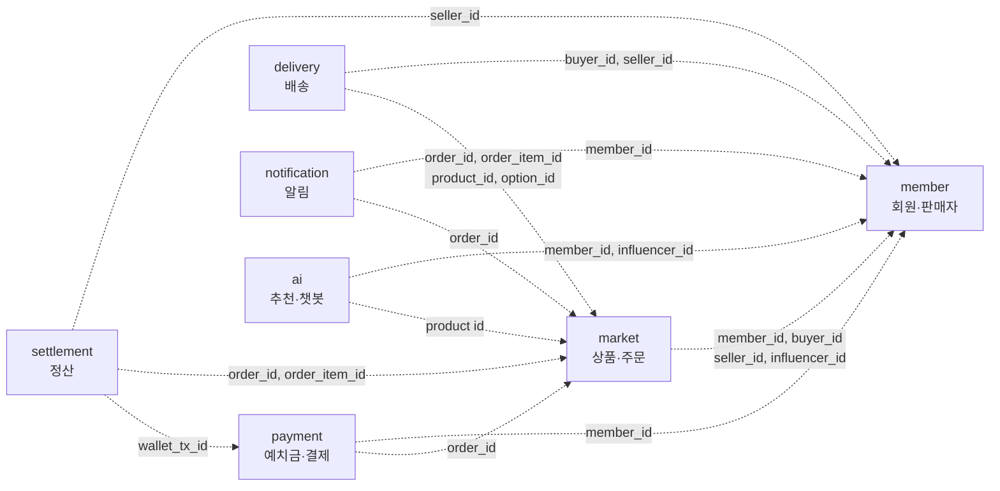

### 서비스별 테이블

눌러서 펼치면 서비스마다 테이블과 컬럼을 볼 수 있습니다. 그림이 넓으면 옆으로 스크롤해 보세요. 주요 컬럼만 추렸습니다.

<b>member</b> · 회원, 판매자, 인플루언서 · 테이블 6개

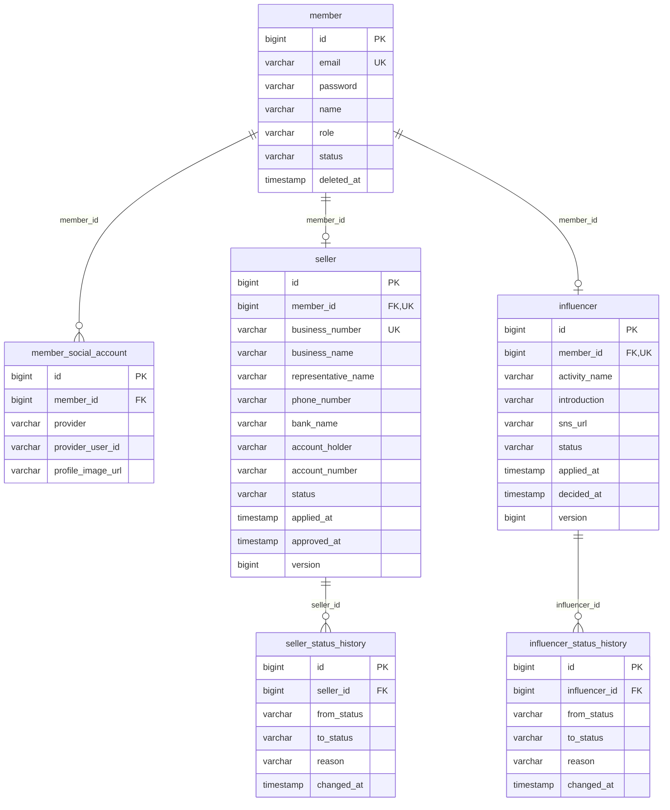

<b>market</b> · 상품, 장바구니, 주문, 쿠폰, 리뷰 · 테이블 20개

#### 상품, 재고

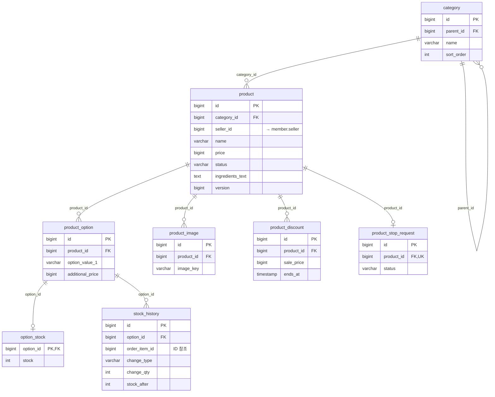

#### 장바구니, 주문

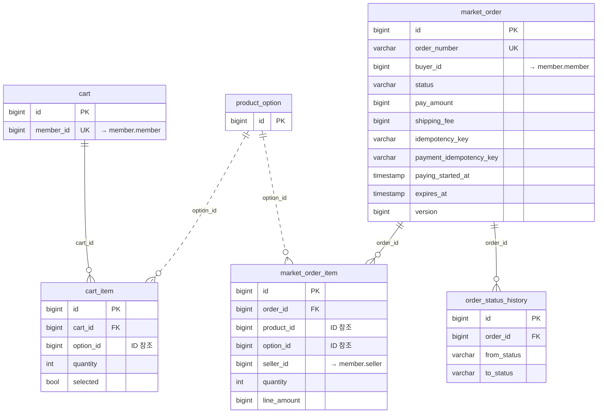

#### 쿠폰, 제휴

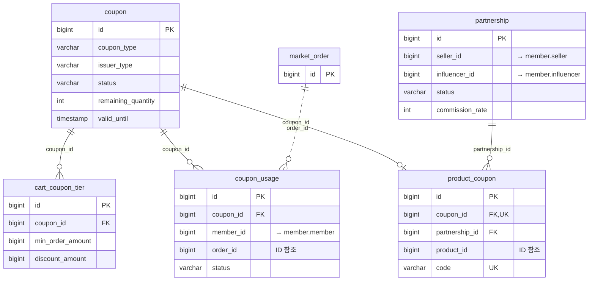

#### 리뷰, 찜

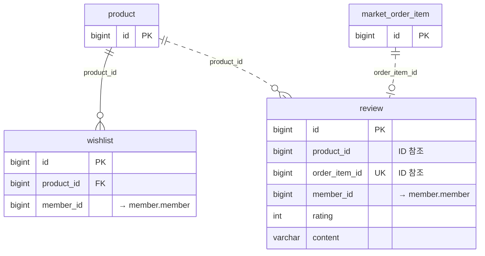

<b>payment</b> · 예치금, 충전, 결제, 환불 · 테이블 7개

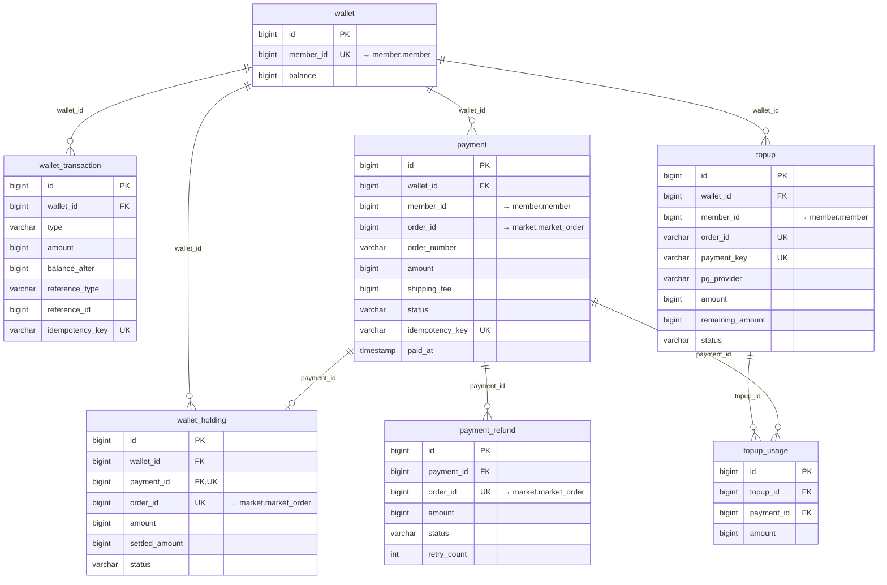

<b>settlement</b> · 월 정산 · 테이블 3개

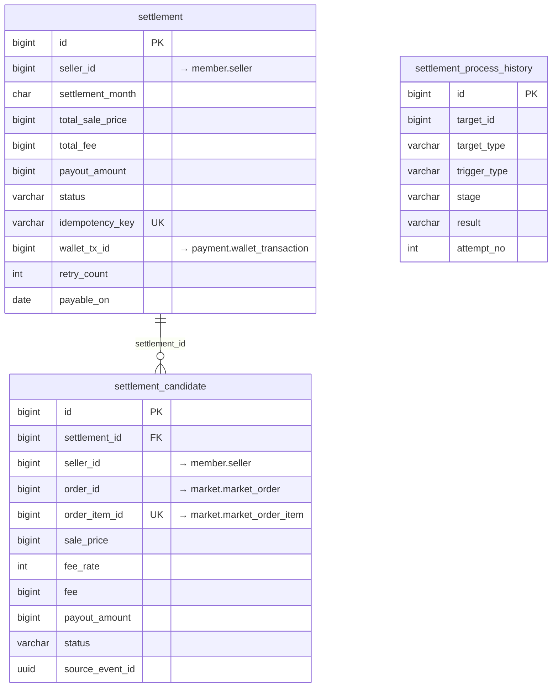

<b>delivery</b> · 배송, 배송 추적 · 테이블 2개

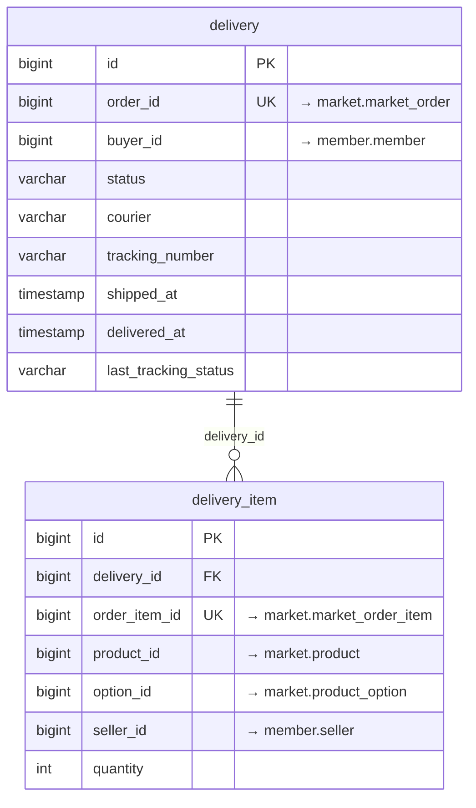

<b>notification</b> · SSE 알림 · 테이블 1개

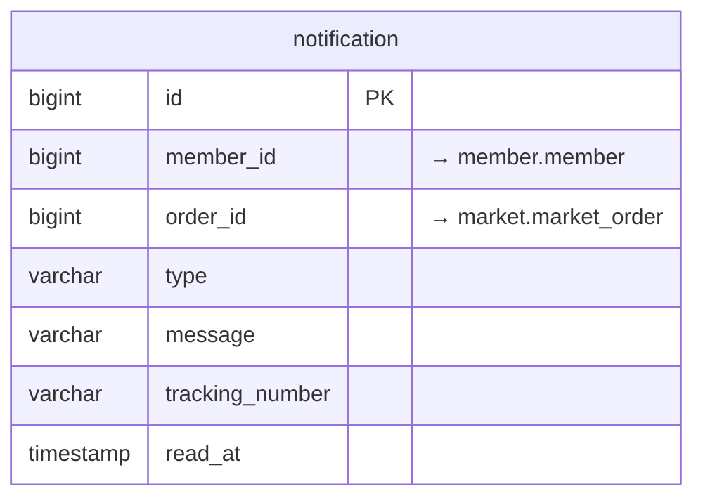

<b>ai</b> · 설문, 맞춤 추천, 챗봇 · 테이블 5개

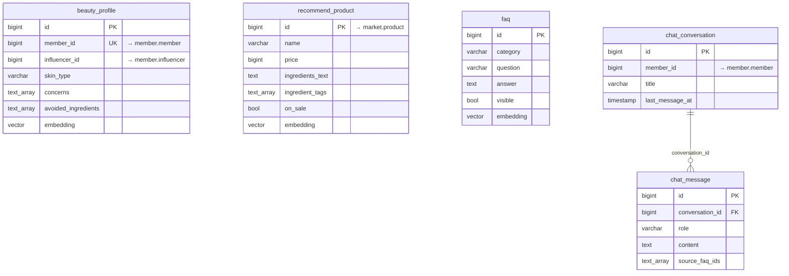

