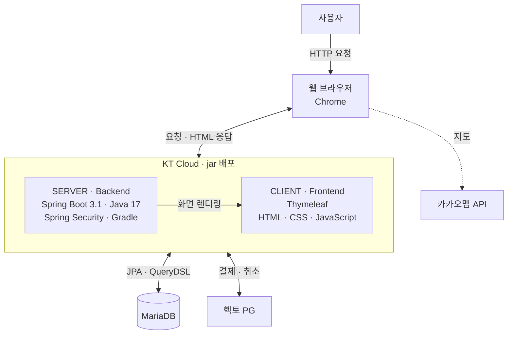
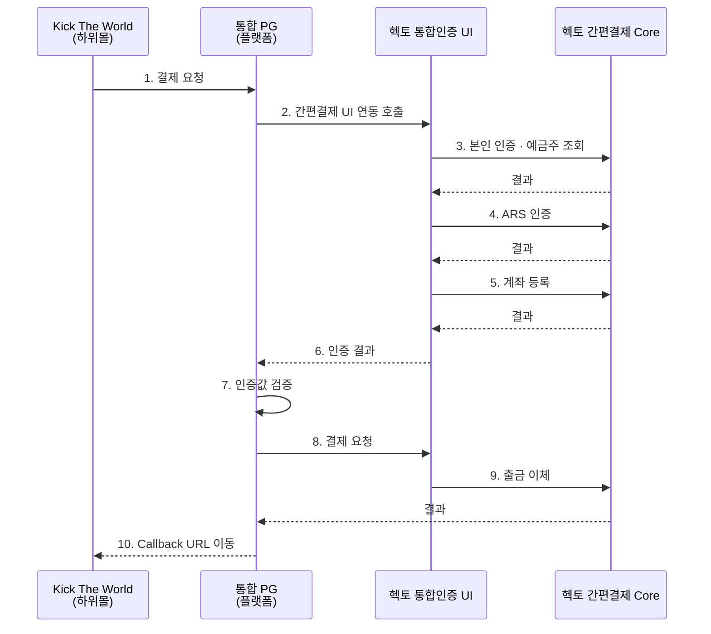

**맡은 일**: 2명 중 숙소 예약 및 결제 담당 (전체 기여도 60%)

## 프로젝트 소개

> "여행을 통해 새로운 가치를 발견하고 세상에 대한 시야를 넓힌다"

**Kick The World**는 인터넷 검색이 익숙하지 않은 중장년층을 위한 여행 웹 서비스입니다. 여행 취향에 맞는 여행지와 코스를 추천하고, 마음에 드는 숙소를 골라 **예약과 결제까지 한 번에** 할 수 있게 했습니다.

- **기간**: 2023.10.26 ~ 2023.12.17
- **팀**: 2인 (졸업작품, **동상 수상**)
- **배포**: KT Cloud 서버에 배포해 운영했고, 지금은 서버를 닫아 둔 상태입니다

### 화면

<div class="shots screens">
<figure><a href="/projects/ktw-stay.webp"></a><figcaption>숙소 상세 · 날짜와 인원을 고르면 최종 결제 금액과 남은 객실 수가 보여요</figcaption></figure>
<figure><a href="/projects/ktw-payment.webp"></a><figcaption>예약 · 약관 동의 후 결제하기를 누르면 헥토 결제폼이 열려요</figcaption></figure>
</div>

### 프로젝트 문서

- **ERD와 테이블 명세서**: [Notion](https://app.notion.com/p/ERD-f0c8151da0e18340a9d88151cc33ecec?pvs=21)
- **API 연동 규격서**: [Notion](https://app.notion.com/p/API-21a8151da0e182449a47012043ecebaf?pvs=21)
- **프로젝트 기획서**: [Google Sheets](https://docs.google.com/spreadsheets/d/1uqItFHQjJ5W67q-imKxkGw0t0J-ilZJWqaTkeOqv4EU/edit?usp=sharing)

## 주요 기능

| 기능 | 내용 |
| --- | --- |
| 맞춤 여행 정보 | 선호하는 여행 취향과 테마로 여행지, 맛집, 숙소와 추천 코스를 필터링. 카카오맵으로 위치 확인 |
| 숙소 예약 | 숙소 목록·상세·검색, 체크인·체크아웃과 인원으로 예약, 예약 내역과 취소 |
| 결제 | 헥토파이낸셜 내통장결제(010Pay) 결제폼 연동, 결제 취소 |
| 여행 커뮤니티 | 자유게시판, 여행 크루 모집, 여행 후기 게시판. 페이징, 댓글, 조회수는 AJAX로 비동기 처리 |
| 회원 | 회원가입·로그인(Spring Security), 마이페이지 |
| 관리자 | Chart.js로 숙소 매출 차트를 그리는 통계 관리 |

## 기술 스택

| 구분 | 기술 |
| --- | --- |
| 언어, 빌드 | Java 17, Gradle |
| 프레임워크 | Spring Boot 3.1, Spring Security, Spring Data JPA, Validation |
| 데이터 | MariaDB, QueryDSL |
| 화면 | Thymeleaf (Layout Dialect, Spring Security Extras), AJAX, Chart.js |
| 외부 연동 | 헥토파이낸셜 내통장결제(010Pay), 카카오맵 |
| 보안 | Jasypt (설정값 암호화) |
| 배포 | KT Cloud (jar 배포) |
| 협업 | GitHub, Notion, Jira |

## 시스템 아키텍처



- **서버**: Spring Boot 하나에서 화면(Thymeleaf)과 API를 함께 처리하는 서버 렌더링 구조입니다. KT Cloud에 jar로 배포했습니다
- **데이터**: MariaDB를 JPA로 다루고, 검색과 페이징은 QueryDSL로 조건을 조합합니다
- **외부 연동**: 결제는 헥토 PG와 서버끼리 통신하고, 지도는 브라우저에서 카카오맵 API를 불러옵니다
- **협업**: GitHub로 코드를, Notion과 Jira로 일정과 문서를 관리했습니다

## 프로젝트 구조

도메인별로 패키지를 나누고, 각 도메인 안에 Controller, Service, Repository, Entity, Dto를 두었습니다.

```
com.example
├── Member     # 회원가입, 로그인(Spring Security), 마이페이지
├── Trip       # 여행지, 추천 코스
├── Stay       # 숙소, 숙소 이미지, 객실 수
├── Eatery     # 맛집
├── Order      # 장바구니, 예약(주문), 예약 취소
├── Pay        # 헥토 결제·취소, 암호화·서명 유틸
├── Board      # 게시판
└── Reply      # 댓글
```

## 설계 포인트

- **결제 금액 위변조 방지**: 헥토 결제 요청과 취소 때 금액은 AES-256으로 암호화하고, 요청값 전체는 SHA-256으로 서명했습니다. 취소 금액은 화면에서 받지 않고 DB에 저장된 결제 금액을 기준으로 보냅니다
- **결제 상태 추적**: 결제 내역을 먼저 저장하고 승인·취소 결과 코드와 거래 번호를 기록해, 주문번호로 결제 상태를 따라갈 수 있게 했습니다
- **초과 예약 방지**: 예약 생성과 객실 차감을 한 트랜잭션으로 묶고, 남은 객실이 없으면 예외를 내는 규칙은 숙소 엔티티 안에 두었습니다. 예약을 취소하면 객실 수를 되돌립니다
- **맞춤 필터링과 페이징**: 여행 취향과 테마 조건이 사용자마다 달라서, QueryDSL로 여러 테이블의 관계를 묶고 조건에 따라 쿼리를 동적으로 만들었습니다. 조회한 결과는 정렬한 뒤 페이징으로 나눠 보여줍니다
- **비동기 게시판**: 게시판의 페이징, 댓글, 조회수는 AJAX로 처리해 페이지를 새로 불러오지 않고 갱신되게 했습니다
- **설정 보호**: DB 접속 정보 같은 민감한 설정값은 Jasypt로 암호화해 저장소에 평문으로 남기지 않았습니다

## 헥토 PG 연동 흐름

숙소 결제는 헥토파이낸셜 **내통장결제(010Pay)** 결제폼으로 연동했습니다. 헥토가 제공하는 연동 스크립트로 결제폼을 띄우고, 예약자 정보와 결제 정보를 보내면 본인 인증, ARS 인증, 계좌 등록과 인증값 검증을 거쳐 결제가 진행됩니다. 결과는 Callback URL로 받습니다.



- **결제 요청**: 주문번호와 금액을 담아 결제를 요청합니다. 금액은 AES-256으로 암호화하고, 요청값 전체는 SHA-256으로 서명해 중간에 바뀌지 않게 했습니다
- **인증과 계좌 등록**: 본인 인증, ARS 인증, 계좌 등록은 헥토 화면에서 처리되어 우리 서버는 계좌 정보를 직접 다루지 않습니다
- **결과 받기**: 결제가 끝나면 Callback URL로 돌아오고, 승인 결과 코드와 거래 번호를 결제 내역에 기록해 주문번호로 상태를 확인할 수 있게 했습니다
- **취소**: 결제 취소도 같은 방식으로 암호화·서명해 요청하고, 취소 금액은 DB에 저장된 결제 금액을 기준으로 보냅니다

## 이슈와 해결

### 결제 인증 스크립트 연동 중 CORS 오류

- **문제**: 헥토 결제 인증 스크립트를 연동하는 과정에서, 다른 출처 사이의 요청이 브라우저의 CORS 정책에 막혔습니다
- **해결**: Spring Security의 `HttpSecurity` 설정에서 CORS를 켜고 허용할 출처를 구성했습니다. 클라이언트에서도 요청에 세션 쿠키가 함께 실리도록 설정해, 로그인한 사용자의 결제 요청이 정상적으로 이어지게 했습니다

## 내가 맡은 일

전체 기여도는 60%입니다.

- **설계**: 요구사항을 분석하고 ERD와 데이터베이스를 설계했습니다
- **숙소**: Spring Boot로 숙소 엔티티를 설계하고 컨트롤러와 서비스 계층을 구현했습니다
- **API와 DB 서버**: RESTful API를 설계하고, 데이터베이스 서버를 구축하고 관리했습니다
- **검색**: QueryDSL로 조건에 따른 검색과 조회, 페이징을 구현했습니다
- **커뮤니티**: AJAX로 댓글과 조회수를 구현했습니다
- **결제**: 헥토 내통장결제(010Pay) 연동 스크립트로 간편 결제를 구현했습니다
- **화면**: 메인 페이지를 디자인했습니다
- **배포**: KT Cloud 서버에 jar 파일로 배포했습니다
