**맡은 일**: PO, 공통 설계, 주문 서비스 분리, 결제 HTTP 연결, 배송 외부 API 연동, 반품, AI 추천, 로그 모니터링

## ERD

- **구성**: 서비스 7개가 PostgreSQL 하나에서 스키마를 나눠 씁니다. 도메인 테이블 44개, FK 32개
- **서비스 사이**: 다른 서비스의 테이블은 FK 없이 ID만 들고 있고(34곳), 데이터는 내부 API와 Kafka 이벤트로 주고받습니다
- **공통 테이블**: 모든 스키마에 `outbox_event`(발행 대기 이벤트)와 `processed_event`(컨슈머 중복 처리 기록)가 있고, settlement에는 Spring Batch 메타 테이블이 더 있습니다
- **기준**: 각 서비스의 Flyway 마이그레이션을 끝까지 적용한 결과입니다

### 서비스 간 참조

화살표는 왼쪽 서비스가 오른쪽 서비스의 ID를 들고 있다는 뜻이고, 라벨은 그 컬럼 이름입니다. FK는 두지 않았습니다.

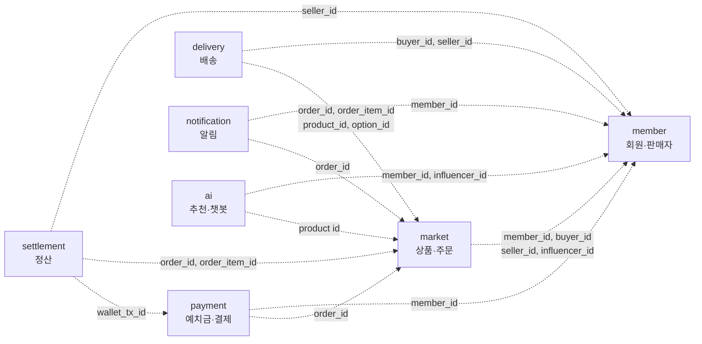

### 서비스별 테이블

눌러서 펼치면 서비스마다 테이블과 컬럼을 볼 수 있습니다. 그림이 넓으면 옆으로 스크롤해 보세요. 주요 컬럼만 추렸습니다.

<details>
<summary><b>member</b> · 회원, 판매자, 인플루언서 · 테이블 6개</summary>

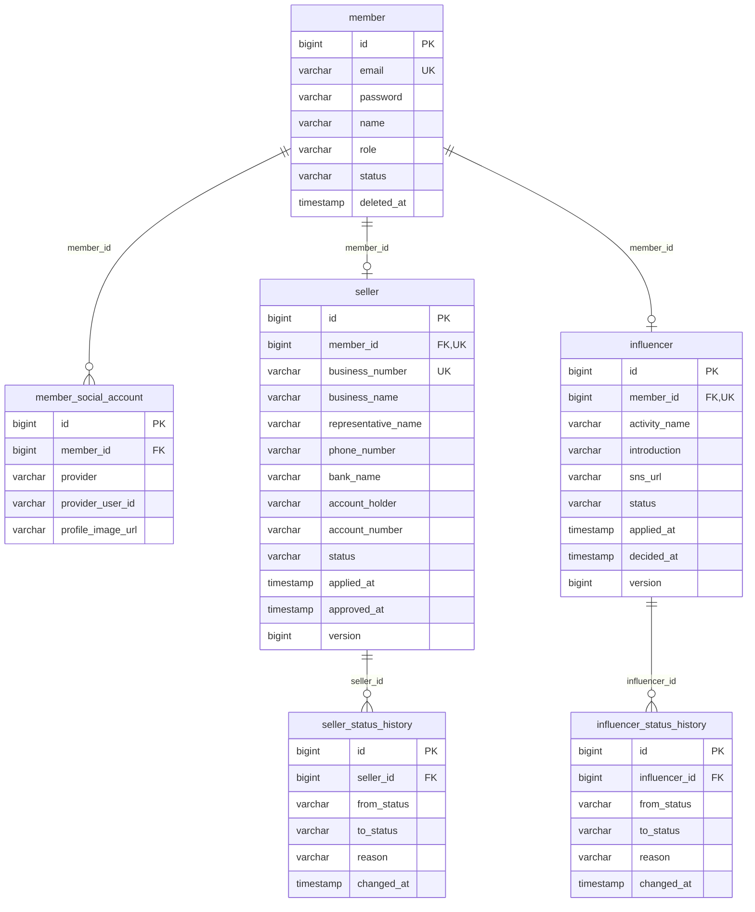

</details>

<details>
<summary><b>market</b> · 상품, 장바구니, 주문, 쿠폰, 리뷰 · 테이블 20개</summary>

#### 상품, 재고

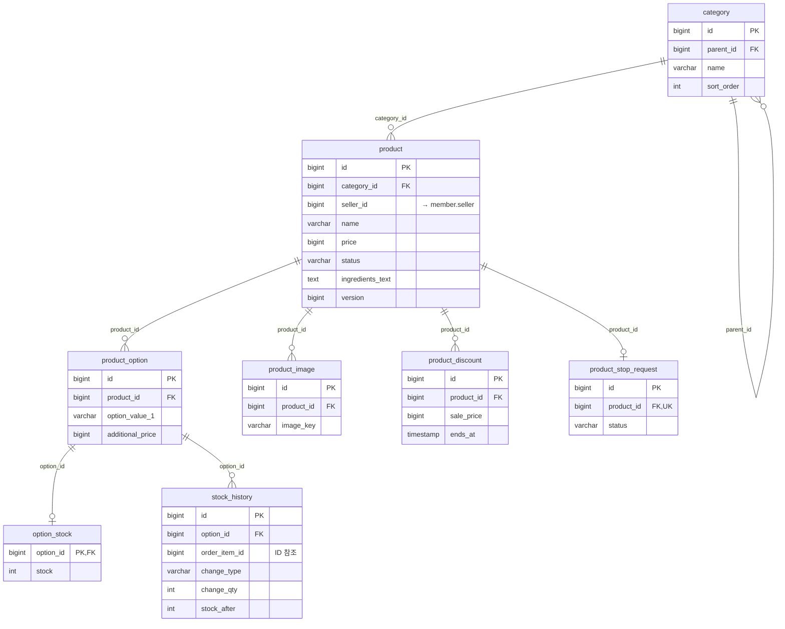

#### 장바구니, 주문

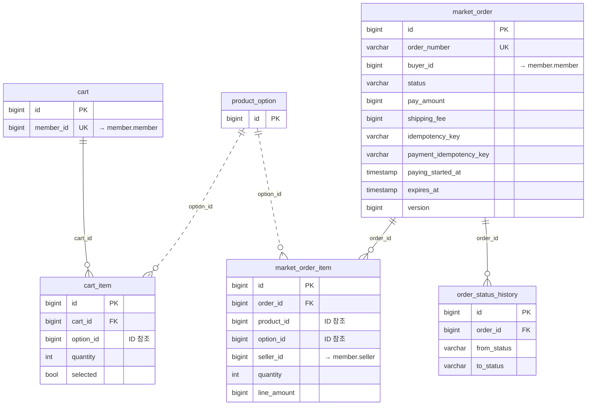

#### 쿠폰, 제휴

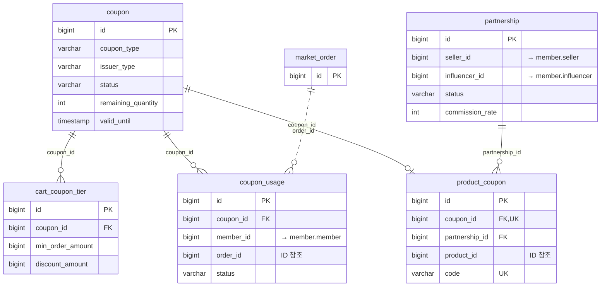

#### 리뷰, 찜

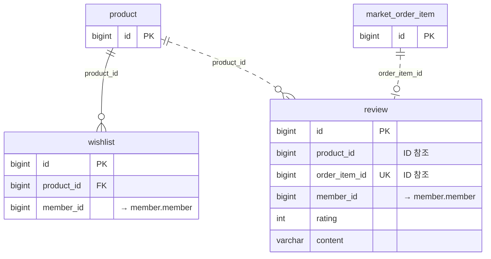

</details>

<details>
<summary><b>payment</b> · 예치금, 충전, 결제, 환불 · 테이블 7개</summary>

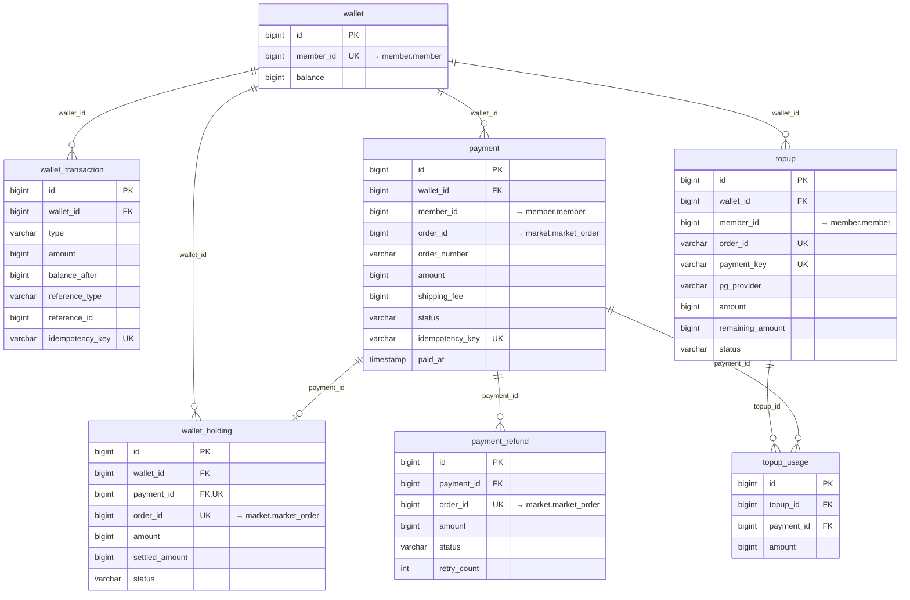

</details>

<details>
<summary><b>settlement</b> · 월 정산 · 테이블 3개</summary>

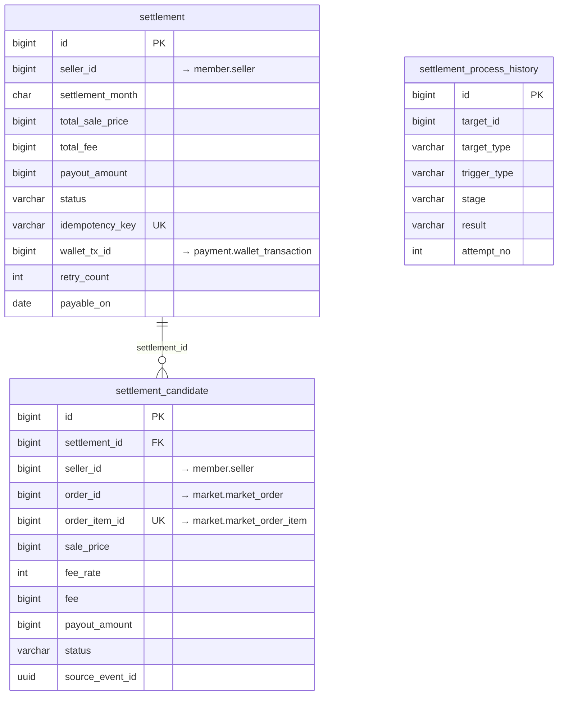

</details>

<details>
<summary><b>delivery</b> · 배송, 배송 추적 · 테이블 2개</summary>

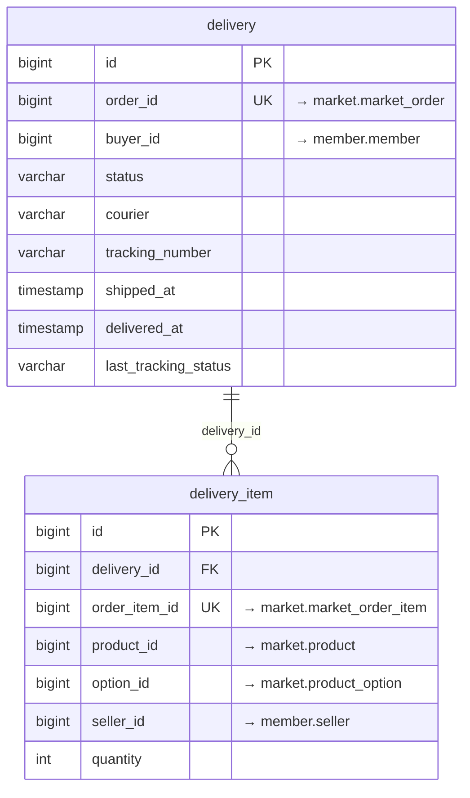

</details>

<details>
<summary><b>notification</b> · SSE 알림 · 테이블 1개</summary>

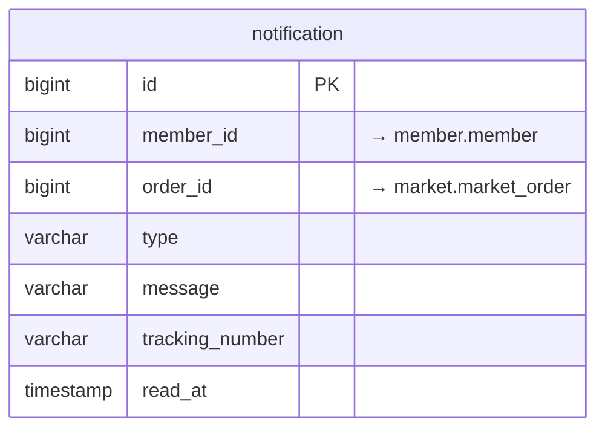

</details>

<details>
<summary><b>ai</b> · 설문, 맞춤 추천, 챗봇 · 테이블 5개</summary>

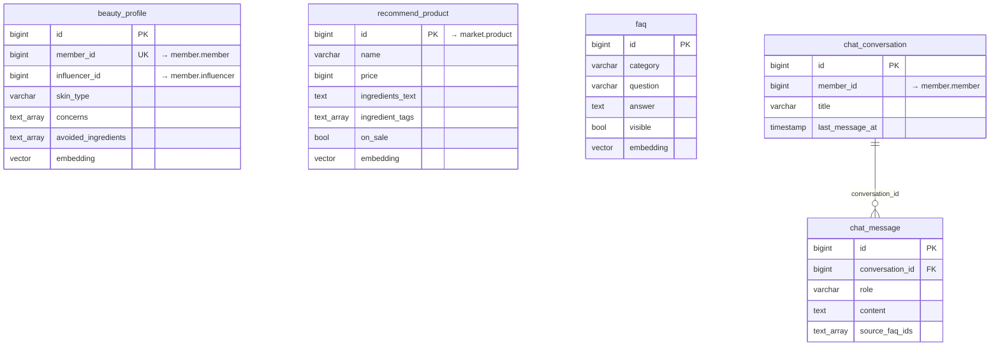

</details>


## 시스템 아키텍처

[](/projects/palette-architecture.png)

- **요청 흐름**: 사용자 → Nginx → Gateway → 6개 서비스(member, market, payment, settlement, delivery, notification)
- **AI 추천**: k3s(Kubernetes) 위에서 HPA로 1~2개까지 자동으로 늘어나도록 했습니다
- **데이터 서버**: 앱 서버와 분리한 EC2에 Kafka, PostgreSQL(+pgvector), Elasticsearch, Redis를 두고 파일은 S3에 저장합니다
- **외부 API**: 토스 결제, 카카오, 메일, OpenAI, 배송 조회, Slack 알림

## 모듈 분리 설계

> 모놀리스(`src/`)를 서비스 모듈로 하나씩 옮긴다. 각 서비스는 **자기 스키마만 읽고 쓰고**, 다른 서비스 데이터는 **내부 API나 Kafka 이벤트로만** 얻는다.

### 1. 프로젝트 구조

```
beadv8_2_TRSS_BE/
├── settings.gradle.kts        # 모듈 등록 (include)
├── build.gradle.kts           # 루트: 공통 빌드 설정 + 기존 모놀리스
├── src/                       # 기존 모놀리스. 서비스가 옮겨질 때마다 비워진다
├── infra/                     # compose, nginx, postgres 초기화 스크립트, 배포 스크립트
│
├── common/                    # 공통모듈
├── gateway/                   # gateway 모듈
├── member-service/            # 회원모듈
├── market-service/            # 상품-주문모듈
├── payment-service/           # 결제모듈
├── settlement-service/        # 정산모듈
├── delivery-service/          # 배송모듈
├── notification-service/      # 알림모듈
└── ai-service/                # AI서비스모듈
```

### 2. 서비스별 담당 기능

| 모듈 | 들어가는 것 | 신규 기능 |
| --- | --- | --- |
| `common` | 공통 웹·JPA·보안, outbox·Kafka, 서비스 간 계약(DTO·이벤트·`XxxApi`), 운영용 슬랙 알림 클라이언트 | |
| `gateway` | 라우팅, JWT 검증, rate limit, CORS | |
| `member-service` | 회원, 판매자, 카카오 OAuth | |
| `market-service` | 상품·재고·검색 / 장바구니·주문 | 리뷰·찜(상품 쪽), 쿠폰·반품(주문 쪽) |
| `payment-service` | 지갑, 충전, 결제, 홀딩 | 환불 |
| `settlement-service` | 정산 후보, 정산 배치, 지급 | |
| `delivery-service` | | 배송 |
| `notification-service` | | 사용자 알림 |
| `ai-service` | | 추천, 리뷰 요약, 챗봇, 벡터 문서 검색 (k3d + HPA) |

- `common`의 슬랙 클라이언트는 **운영 알림**(장애, 배치 실패)용이다. 사용자에게 가는 알림은 `notification-service`가 맡는다.
- 반품은 market(주문 상태 변경), 환불은 payment(돈 이동)가 맡는다. 반품이 승인되면 market이 이벤트를 발행하고 payment가 환불한다.

### 3. DB 분리

#### 스키마와 테이블 소유권

| 서비스 | 스키마 | 계정 | 테이블 |
| --- | --- | --- | --- |
| member-service | `member` | `member_user` | 회원, 판매자 |
| market-service | `market` | `market_user` | 상품, 옵션, 카테고리, 재고 이력, 이미지, 판매 중지 요청 (+ 리뷰·찜) · 장바구니, 주문, 주문 항목, 상태 이력 (+ 쿠폰·반품) |
| payment-service | `payment` | `payment_user` | 지갑, 원장, 충전, 결제, 홀딩 (+ 환불) |
| settlement-service | `settlement` | `settlement_user` | 정산 후보, 정산서, Spring Batch 메타 테이블 |
| delivery-service | `delivery` | `delivery_user` | 배송 |
| notification-service | `notification` | `notification_user` | 알림 |
| ai-service | `ai` | `ai_user` | 대화 기록, 벡터 색인 (pgvector) |

- `outbox_event`, `processed_event`는 서비스마다 **자기 스키마 안에** 둔다. 서비스 담당자가 첫 Flyway 마이그레이션에 넣는다.
- 서비스 간 외래키는 두지 않는다. 다른 서비스의 ID는 값(`memberId`, `orderId`)으로만 저장한다.
- `(+ …)`는 신규 기능으로 생길 테이블이다.

#### 계정 구성

| 계정 | 권한 | 쓰는 곳 |
| --- | --- | --- |
| 슈퍼유저 (`.env`의 `DB_USERNAME`) | 전체 | 초기화 스크립트, 테이블 이동, 백업, 장애 대응. 인프라 담당만 쓴다 |
| 서비스 계정 (`market_user` 등) | 자기 스키마의 소유자 | 각 서비스 앱과 그 서비스의 Flyway |
| `readonly_user` | 모든 스키마 읽기만 | 팀원 디버깅, 데이터 확인, Grafana 조회 |

- 슈퍼유저는 `compose.prod.yaml`의 `POSTGRES_USER`로 만들어진 계정이다.
- 스키마와 계정은 `infra/postgres/init/01-init-schemas.sh`가 만든다. 비밀번호는 `.env`의 `{SERVICE}_DB_PASSWORD`이다.
- `readonly_user`는 나중에 생기는 테이블도 자동으로 읽을 수 있다(`ALTER DEFAULT PRIVILEGES`).
- 새 서비스를 추가하면 초기화 스크립트에 스키마·계정 한 줄과 `readonly_user` 권한 한 줄을 더한다. **지금 `delivery`, `notification`은 스크립트에 없다.**

### 4. 서비스 간 통신

| 방식 | 언제 | 규칙 |
| --- | --- | --- |
| 내부 API (동기) | 결과가 바로 필요할 때 (회원 상태 확인, 결제 요청) | `/internal/v1/{리소스}`, 헤더 `X-Internal-Key`, 주소는 `{SERVICE}_SERVICE_URL` 환경 변수 |
| Kafka 이벤트 (비동기) | 다른 서비스에 알리기만 하면 될 때 (가입, 제재, 구매 확정) | outbox에 저장 → relay가 `{aggregate}.events` 토픽으로 발행 → 받는 쪽은 `processed_event`로 중복 처리를 막는다. 실패는 `{토픽}-dlt`로 보낸다 |

- 사용자 JWT는 gateway가 생기기 전까지 각 서비스가 같은 `JWT_SECRET`으로 직접 검증한다.
- 경로가 어느 서비스 것인지는 "API 경로 소유표" 문서를 따른다.

### 5. 배포와 포트

| 서비스 | 포트 | 실행 위치 | 주요 의존 |
| --- | --- | --- | --- |
| `gateway` | 8000 | EC2-A Compose | Redis (rate limit) |
| 기존 모놀리스 | 8080 | EC2-A Compose | 전환 기간에만 둔다. 모든 서비스가 옮겨지면 없앤다 |
| `member-service` | 8081 | EC2-A Compose | Postgres(member), Redis(리프레시 토큰, 로그인 시도, 이메일 인증), Kafka, 카카오 API |
| `market-service` | 8082 | EC2-A Compose | Postgres(market), Kafka, Elasticsearch |
| `payment-service` | 8083 | EC2-A Compose | Postgres(payment), Kafka |
| `settlement-service` | 8084 | EC2-A Compose | Postgres(settlement), Kafka |
| `delivery-service` | 8085 | EC2-A Compose | Postgres(delivery), Kafka |
| `notification-service` | 8086 | EC2-A Compose | Postgres(notification), Kafka |
| `ai-service` | 8087 | EC2-A k3d | Postgres(ai, pgvector), Kafka, LLM API |
| Postgres · Kafka · Elasticsearch | 5432 · 9092 · 9200 | EC2-B Compose | - |

- 밖에서 들어오는 요청은 nginx(80/443) → gateway(8000) → 각 서비스 순서로 간다. gateway가 생기기 전에는 nginx가 경로별로 서비스에 바로 보낸다.
- 서비스 포트는 EC2 밖으로 열지 않는다.
- EC2-A 한 대에 JVM 8개와 k3d가 올라간다. 컨테이너마다 메모리 상한(`mem_limit`)과 `Xmx`를 정해 둔다 (market은 1g).

### 6. EC2 구성

| EC2-A: t3.large | 메모리 (추정) |
| --- | --- |
| OS + Docker | 약 0.5GB |
| nginx + Redis | 약 0.2GB |
| gateway + 서비스 6개 (약 600MB × 7) | 약 4.2GB |
| ai-service (약 700MB × 1~3) | 0.7 ~ 2.1GB |
| k3d 노드 | 약 0.5GB |
| 로그 모니터링 | 약 0.5 ~ 1.0GB |
| 합계 | **약 6.6 ~ 8.5GB / 8GB** |

| EC2-B: t3.medium | 메모리 (추정) |
| --- | --- |
| OS + Docker | 약 0.5GB |
| Postgres(pgvector) | 약 0.5GB |
| Kafka (힙 512MB) | 약 0.8GB |
| Elasticsearch (힙 768MB, nori) | 약 1.5GB |
| 합계 | **약 3.3GB / 4GB** |

## 설계

### 설계 기준

- 장애가 **다른 서비스로 번지지 않게**
- 결과를 모르는 결제도 **한 결과로**
- DB와 이벤트가 **어긋나지 않게**
- 동시 요청에도 **재고가 맞게**

### 주문, 결제 흐름

- **동기 (HTTP)**: 주문 서비스(PAYING 저장) → HTTP, 멱등 키 → 결제 서비스 → 응답 → 주문 확정(PAID)
  - 시간 초과로 결과를 모르면 재확인 스케줄러가 같은 멱등 키로 다시 확인하고, 반영할 수 없으면 취소로 보상
- **비동기 (이벤트)**: 주문 DB(상태 변경 + outbox) → 릴레이 → Kafka(order.events) → 정산, 배송, 결제(중복 처리 차단)
  - 상태 변경과 이벤트 저장을 한 트랜잭션으로 묶어 DB와 이벤트가 어긋나지 않게

### 서비스 분리와 기술 선택

- **서비스 분리**: 주문, 재고, 결제가 한 트랜잭션으로 묶인 모놀리스를 장애 격리와 도메인별 병렬 개발을 위해 7개 서비스와 Gateway로 나눴습니다
- **Outbox, Kafka**: 커밋 후 바로 발행하면 전송이 실패했을 때 이벤트가 사라지기 때문에 Transactional Outbox를 선택했고, 전달은 실패해도 메시지를 다시 읽을 수 있는 보관과 재처리, 같은 주문의 이벤트를 차례대로 처리하는 순서 보장이 필요해 Kafka로 결정했습니다

## 개발

### 결제와 이벤트 정합성

- **결제 연결**: 서비스를 나누면서 주문과 결제를 함께 롤백할 수 없고 시간 초과가 나면 결제가 됐는지 알 수 없어서, PAYING 상태와 같은 멱등 키로 다시 호출하는 방식으로 응답을 받지 못한 결제도 하나의 결과로 수렴시키고 반영할 수 없으면 취소로 보상했습니다
- **이벤트 발행**: DB 커밋과 이벤트 발행이 따로 실패하면 정산과 배송이 서로 다른 상태를 보게 되어, Outbox 패턴과 Kafka로 대상별 순서를 보장하고 컨슈머 중복 처리를 막았습니다
- **반품, 환불**: 재고 복원과 이벤트 발행을 한 트랜잭션으로 묶고 환불 확인 스케줄러를 더해 환불 누락을 알림으로 잡아내도록 했습니다

### 동시성과 중복 처리

- **만료 직전 결제**: 만료 직전의 결제와 만료 스케줄러가 같은 주문을 동시에 처리하는 문제를 비관적 락과 상태 재확인으로 막아 결제, 취소, 만료 중 하나만 반영되게 했습니다
- **교착 방지**: 잠금 순서를 상품(ID 오름차순), 주문 순으로 고정해 교착이 생길 여지를 없앴습니다
- **중복 주문**: Idempotency-Key와 유니크 인덱스, 장바구니 잠금으로 중복 주문과 재고 중복 차감을 막았습니다
- **배치 처리**: id 커서로 나눠 건 단위로 처리해 한 건이 실패해도 다른 주문에는 영향이 없도록 했습니다

### AI 추천과 개발 방식

- **AI 추천**: 임베딩은 요청 경로 밖에서 미리 만들고 기피 성분은 SQL 하드 필터로 제외해서, 외부 장애가 있어도 추천은 응답하고 기피 성분 상품은 추천되지 않습니다
- **개발 방식**: 로컬에서 Claude Code 하네스를 설계, 개발, 테스트, QA 에이전트로 나눠 썼고, PR 공유 스킬과 ERROR 알림 봇을 팀 스킬로 만들었습니다

## 배포

### 서버 구성과 배포

- **앱 서버 (EC2-A)**: Docker Compose로 Nginx, Gateway, 서비스 6개, 모니터링을 띄우고, AI 서비스는 k3s에서 HPA로 1~2개까지 늘어납니다
- **데이터 서버 (EC2-B)**: Kafka, PostgreSQL(서비스별 스키마 + pgvector), Elasticsearch, Redis를 앱 서버와 분리했습니다
- **CI/CD**: develop 브랜치에 머지되면 GitHub Actions가 서버에 배포합니다

### 검증과 운영

- **부하 테스트**: k6로 재고 100개에 300명 동시 주문, 버튼 연타, 5분 연속 구매 상황을 만들고 DB에서 재고와 결제를 대조해 재고, 결제 오류 0건과 서버 에러 0건을 확인했고, 초당 17건까지는 지연 없이 처리했습니다. 병목은 재고 잠금을 기다리는 동안 커넥션 풀이 고갈되는 부분이었습니다
- **모니터링**: Alloy, Loki, Grafana로 로그를 모으고, ERROR는 Slack으로 알리고, Prometheus로 메트릭을 수집했습니다
